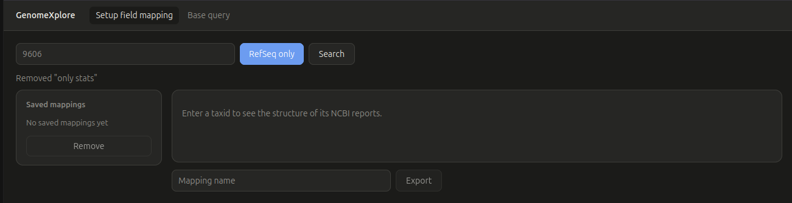
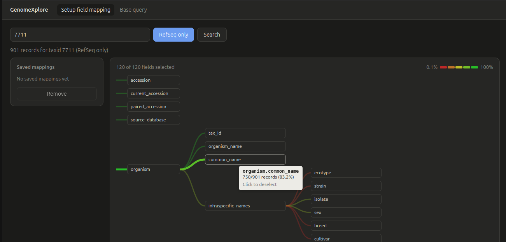
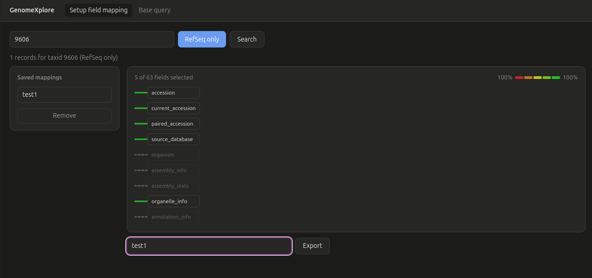
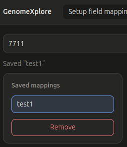
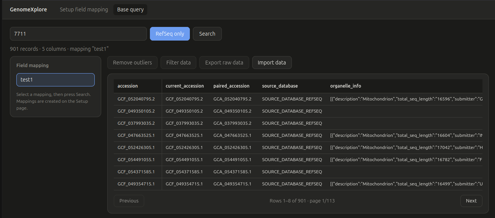
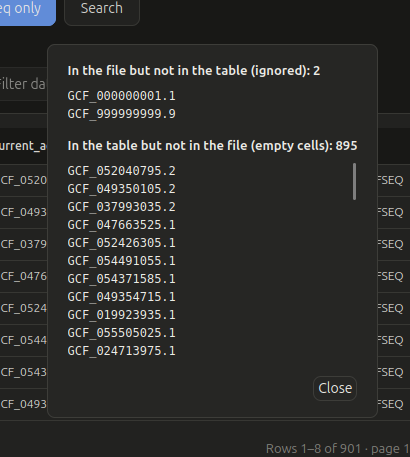
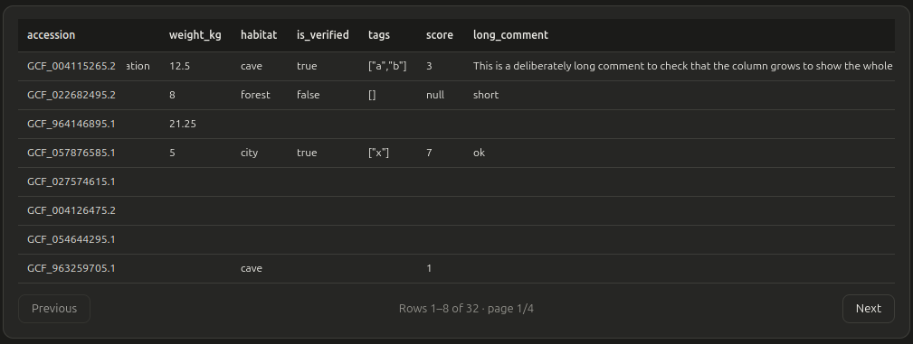

# GenomeXplore

*A platform to explore and select reference genomes and their associated raw data.*

## Credits

|                         |                                                                                                                                                                      |
| ----------------------- | -------------------------------------------------------------------------------------------------------------------------------------------------------------------- |
| **Developers**          | [First name Last name] and [First name Last name], Master 2 Bioinformatics, Université Claude Bernard Lyon 1                                                         |
| **Project proposed by** | Bioinformatics and Biostatistics team, *Centre International de Recherche en Infectiologie* (CIRI: CNRS UMR5308, INSERM U1111, UCBL1, ENSL)                          |
| **Framework**           | University project (UE "Projet Bioinformatique 3"), 2026                                                                                                             |
| **Version**             | 1.0                                                                                                                                                                  |

---

## 1. Project presentation

### Context

Comparative genomics studies, such as the evolution of viral restriction factors (OAS, PKR, APOBEC, TRIM, Mx...) in chordates, need well-assembled and well-annotated genomes. For example, analysing regulatory sequences (motif conservation in UTRs) only makes sense if the UTRs are correctly annotated. Associating representative raw data with the genomes (RNA-seq first, but also ChIP-seq or Hi-C) would also help to re-evaluate the quality of the annotations.

The difficulty is that these resources are scattered across NCBI (USA), Ensembl (Europe) and NGDC/GWH (China), with different formats, nomenclatures and quality levels, and the metadata of the sequence data are noisy free text. Selecting genomes by hand is slow and hard to reproduce.

### Objective

Give researchers a local web application to make this selection faster and reproducible: gather the genome and annotation metadata from the public databases, choose the reference genomes to include in a study, and associate representative raw data with them.

### What it does and how it is used

GenomeXplore works in three steps:

1. **Explore**: search a taxon (NCBI taxid) to see which metadata fields exist in its reference assembly reports, and how complete each one is.
2. **Choose**: select the fields that matter for your study and save them as a reusable *field mapping*, which can be shared with other people.
3. **Compare**: get a table with one row per assembly and only the chosen fields, and import your own values (for example the results of an external analysis) as extra columns.

> **Current state (V1):** the data source is NCBI reference assemblies (RefSeq, and GenBank when RefSeq only is switched off). You can explore the fields, save field mappings, query the table and import your own data. The next steps are listed in the [roadmap](#4-potential-improvements).

The installation and the detailed use of each page are described in [How to use](#2-how-to-use).
---

## 2. How to use

<!-- TODO: installation method: replace the virtual environment below with Docker or another method -->

### Install

Create a virtual environment and install the required libraries (`fastapi`, `uvicorn`, `requests`):

```bash
python -m venv .venv
source .venv/bin/activate        # Windows: .venv\Scripts\activate
pip install fastapi uvicorn requests
```

### Launch

From the project directory (`genomexplore/V1.0`, the folder that contains `backend/` and `frontend/`):

```bash
uvicorn backend.main:app
```

Then open <http://127.0.0.1:8000> in your browser.

### Web page use

The app has two pages, reachable from the menu at the top: **Setup field mapping** (the page the app opens on) and **Base query**. The workflow is: **(1)** search a taxid on the Setup page, **(2)** select the fields you need and save them as a *field mapping*, **(3)** use that mapping on the Base query page.

#### Setup field mapping page



**1. Search a taxid.** Enter a valid NCBI taxid (e.g. `9606` for human, `7711` for chordates) and click **Search**.
- **RefSeq only** toggle: *on* = RefSeq assemblies only, *off* = all reference assemblies (RefSeq and GenBank).
- The search can take some time, especially with RefSeq off and/or a large taxonomic level.
- An invalid taxid gives an error message, and a taxid without results shows "0 records".

**2. Read the schema tree.** The result is the *schema tree* of the NCBI reports: one button per field, with the fields of a branch (e.g. `organism`) to its right.



- **Hover** a field to see how many reports have it (e.g. `750/901 records (83.2%)`).
- The branch colours show how often the field exists, from the **lowest percentage** in the data (red, legend at the top right) to **100%** (green).
- The top left counter shows how many fields are selected.

**3. Select the fields.** Click a field to deselect it, and click again to restore it. Clicking a field with sub-fields deselects the **whole branch**.

**4. Save a field mapping.** Type a name under the tree and click **Export**. The name must be unique and at least one field must be selected. The mapping appears in the **Saved mappings** list on the left.



**5. Use saved mappings.**
- **View**: click a mapping in the list. The tree shows only its fields.
- **Edit**: deselect more fields and save under a new name. Fields missing from a saved mapping cannot be brought back from it: deselect the mapping (click it again) to see the current search again, or do a new search.
- **Remove**: select a mapping, then click **Remove**.



> **Sharing a mapping:** mappings are stored in `backend/storage/field_mappings.json` (format in [backend/storage/README.md](backend/storage/README.md)). To share them, send this file or copy only the mappings you want into the other person's file. Names must stay unique.

#### Base query page

**1. Run a query.** Select a field mapping in the list (without one you get "Select a field mapping first"), enter a taxid, choose RefSeq on/off and click **Search**. If the taxid and RefSeq setting are the same as your last search (on any page), the data loads instantly: the NCBI request is not repeated.

**2. Read the results.**



- One **row per assembly** (first column = accession) and one **column per field of the mapping**. A cell is empty when the assembly does not have that field. Hover a column name to see its full path.
- With many results, use **Previous** and **Next** to change page.

**3. Import your own data.** The **Import data** button (do a search first) adds your own values to the table as new columns. Nothing is sent to the server or saved: the new columns are lost on a new search. Choose a `.json` file with one entry per accession, each holding `column name: value`:

```json
{
  "GCF_000001405.40": { "weight_kg": 12.5, "habitat": "cave", "is_verified": true },
  "GCF_000001635.27": { "weight_kg": 8,    "habitat": "forest" }
}
```

- The accessions must match the table. Columns can differ between accessions, and a missing value stays empty. An imported column with the name of an existing one replaces it.
- A popup lists what could not be matched: accessions in the file but not in the table (ignored), and in the table but not in the file (empty cells).

| Import report | New columns |
| :---: | :---: |
|  |  |

> **Not available yet:** the **Remove outliers**, **Filter data** and **Export raw data** buttons are disabled ("Coming soon").

---

## 3. Code infrastructure

GenomeXplore has two components, each with its own README that details every folder and script:

| Component    | Role                                                                     | Details                                        |
| ------------ | ------------------------------------------------------------------------ | ---------------------------------------------- |
| **Backend**  | NCBI queries, data transformation, storage of the mappings (Python, FastAPI) | [backend/README.md](backend/README.md)     |
| **Frontend** | Web pages and interactivity (plain HTML / CSS / JavaScript modules)      | [frontend/README.md](frontend/README.md)       |

The backend also serves the frontend files, so a single `uvicorn` command starts everything.

### How it works

Both pages start from a taxid search and need the same raw NCBI data, which the backend downloads once and reuses.

```text
Setup page:   taxid ─► NCBI reports ─► fields and how often they exist ─► user selects fields ─► saved field mapping
Query page:   taxid + field mapping ─► NCBI reports ─► table (one row per assembly, mapped fields only) ─► + imported data
```

The detailed script-by-script workflows are in the backend and frontend READMEs. They also explain how to add a route, a page, a component or a stylesheet.

---

## 4. Potential improvements

### Next version (V2)

- **Minimal raw data export**: export the raw data information of the selected assemblies (for example their accessions and download links) for use in external pipelines. This is the **Export raw data** button, currently disabled.

### Following version (V3)

- **Filtering** of the assemblies (**Filter data** button, currently disabled).
- **Outlier detection and removal** (**Remove outliers** button, currently disabled).

### Later

- **Other databases**: GWH and Ensembl, for assemblies and for raw data.
- **More NCBI assemblies**: non-reference assemblies.
- **Search by name**: common name and scientific name, in addition to the taxid.
- **Table**: ordering by column, show/hide columns, select/deselect rows.
- **Improved versions** of the features above (for example a fuller raw data export).
