# GenomeXplore

## 1. Project presentation

<!-- TODO: describe the project -->

---

## 2. How to use


### import method (instalation) : (replace current with docker or other method)

### Create a virtual environment

Create a virtual environment and install the following libraries:

- `fastapi`
- `uvicorn`
- `requests`

```bash
python -m venv .venv
source .venv/bin/activate        # Windows: .venv\Scripts\activate
pip install fastapi uvicorn requests
```

### Launch the web page

Go to the project directory (`genomexplore/V1.0`, the folder that contains `backend/` and `frontend/`) and run:

```bash
uvicorn backend.main:app
```

Then open <http://127.0.0.1:8000> in your browser.

---

### Web page use

The app has two pages, reachable from the menu at the top: [Setup field mapping](http://127.0.0.1:8000/#/setup-field-mapping) and [Base query](http://127.0.0.1:8000/#/base-query). The app opens on the **Setup field mapping** page.

The typical workflow is: **(1)** search a taxid on the Setup page, **(2)** select the fields you need and save them as a *field mapping*, **(3)** use that mapping on the Base query page to get a table of results.

#### Setup field mapping page

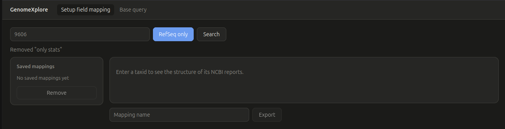

From top to bottom: the page menu, the search bar, a status line, the list of saved field mappings (left) and the display area (right).

##### 1. Search a taxid

Enter a valid NCBI taxid (e.g. `9606` for human, `7711` for chordates) and click **Search** (or press Enter).

- **RefSeq only** toggle: *on* = RefSeq assemblies only. *Off* = all reference assemblies, RefSeq and GenBank (GenBank assemblies that are not in RefSeq yet are included).
- The search can take some time, especially with RefSeq off and/or a large taxonomic level (a "Searching…" message is shown).
- An invalid taxid gives an error message, and a taxid without results shows "0 records".

| Not a number | No result | Search running |
| :---: | :---: | :---: |
| 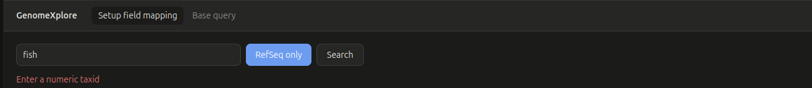 | 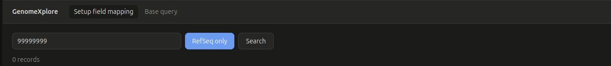 | 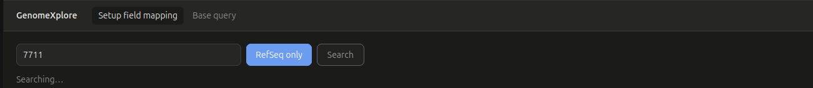 |

##### 2. Read the schema tree

The result is the **schema tree** of the NCBI reports: one button per field, with the fields of a branch (e.g. `organism`) displayed to its right.

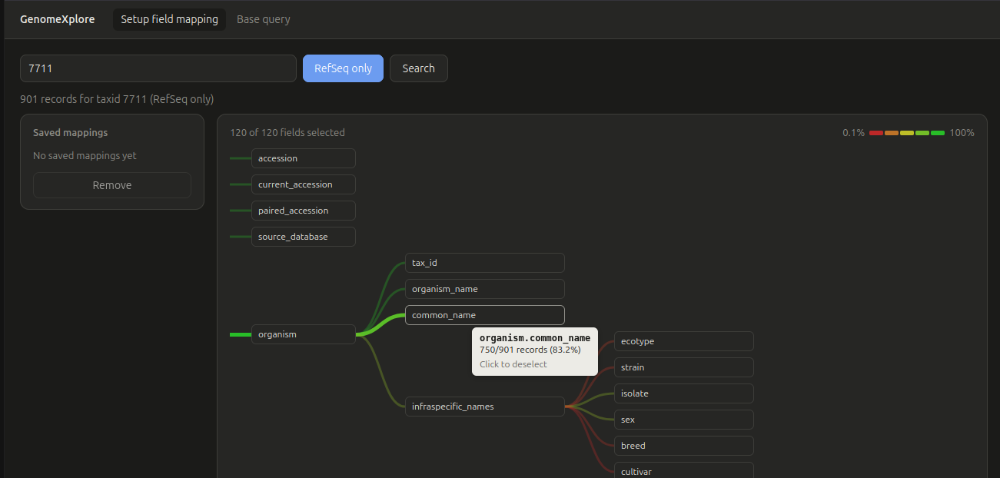

- **Hover** a field to see how many reports have it (e.g. `750/901 records (83.2%)`).
- The colour of the branches shows how often the field exists. The legend at the top right goes from the **lowest percentage** found in the data (red) to **100%** (green).
- The top left counter shows how many fields are selected (`120 of 120 fields selected`).

##### 3. Select the fields you want

Click a field to **deselect** it, and click it again to restore it. Clicking a field that has sub-fields deselects the **whole branch** (its fields can be restored the same way).

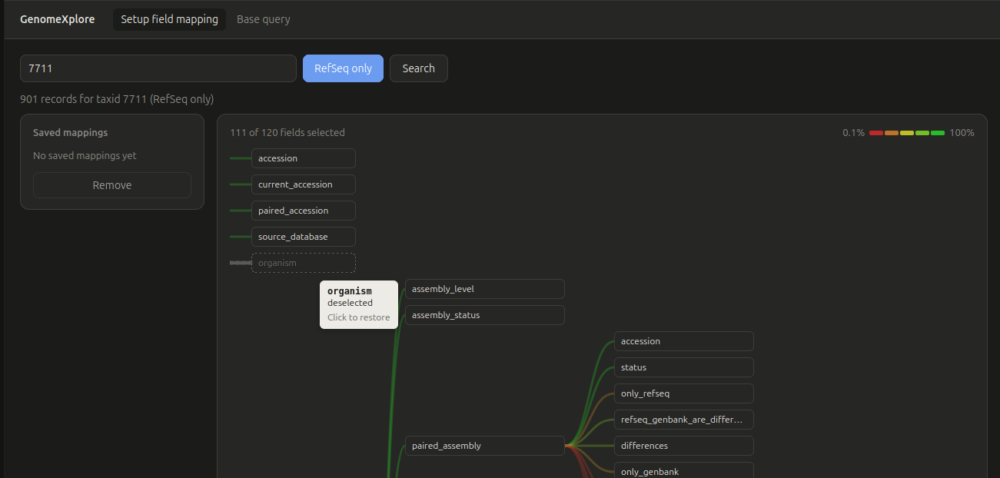

##### 4. Save a field mapping

Type a name in the box under the tree and click **Export**. The mapping contains the selected fields only. Names must be unique (no duplicates allowed), and at least one field must be selected.

The new mapping appears in the **Saved mappings** list on the left.

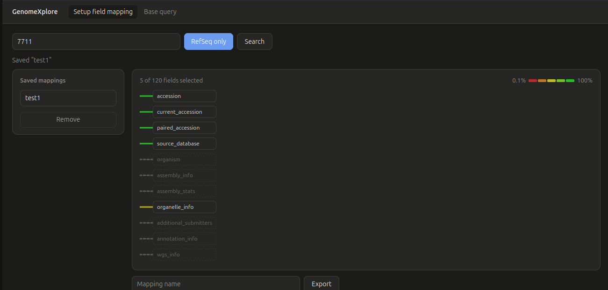

##### 5. Use saved mappings

- **View** a mapping: click it in the list. The tree now shows only the fields of that mapping.
- **Edit** a mapping: deselect more fields, then save under a new name. The fields removed from a saved mapping cannot be brought back (they are no longer in the mapping). To get them back, do a new search or, if it is the current search, deselect the mapping (click it again): the tree shows the current search result again, if there is one.
- **Remove** a mapping: select it, then click **Remove**.

| Mapping selected | Mapping removed |
| :---: | :---: |
| 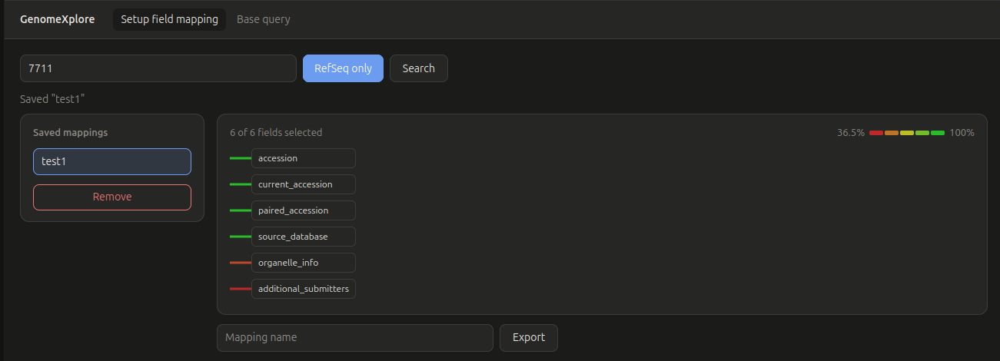 | 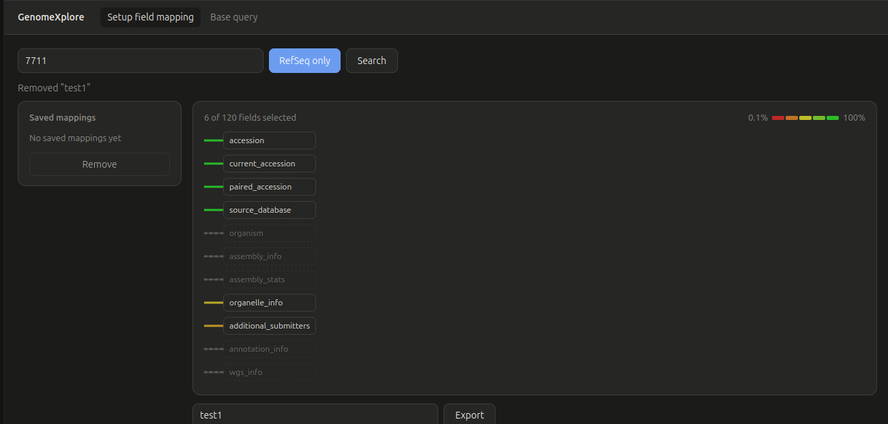 |

> **Sharing a mapping:** mappings are stored in the local file `backend/storage/field_mappings.json`. To share them with someone else, send this file, or copy-paste only the mapping(s) you are interested in into their file (see [storage](#storagefield_mappingsjson) for the format). Each name must stay unique in the file.

#### Base query page

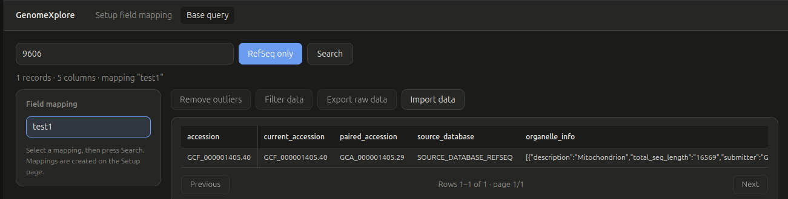

The page has the same search bar as the Setup page, and the mapping list on the left (it shows the same saved mappings).

##### 1. Run a query

1. **Select a field mapping** in the list (a query does not work without one: you get "Select a field mapping first").
2. Enter a taxid, choose RefSeq on/off, and click **Search**.

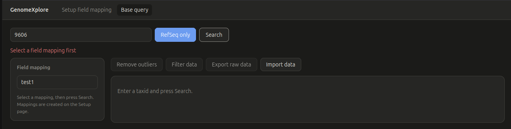

> If the taxid and RefSeq setting are the same as your last search (on any page), the data loads instantly: the NCBI request is not repeated.

##### 2. Read the results

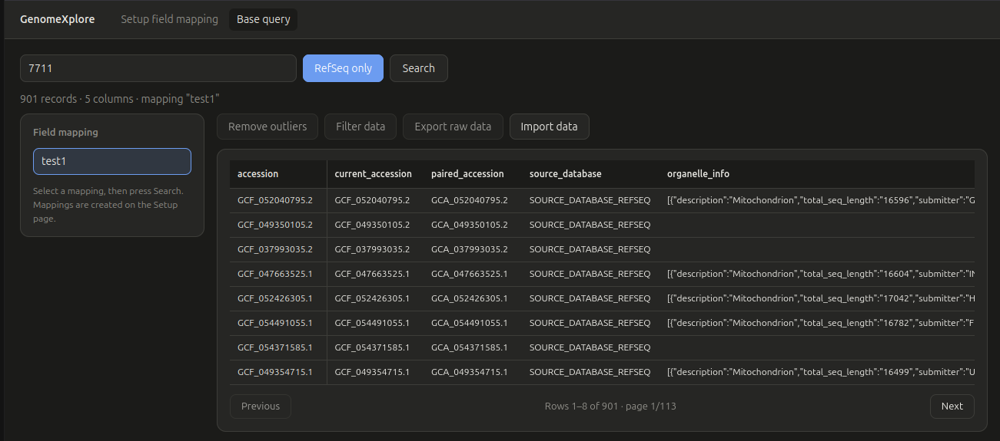

- One **row per assembly** (first column = accession) and one **column per field of the selected mapping**. A cell is empty when the assembly does not have that field. Hover a column name to see its full path.
- The status line gives the number of records and columns.
- With many results, use **Previous** and **Next** to go through the pages (the number of rows per page adapts to your screen).

##### 3. Import your own data

The **Import data** button adds your own values to the table as new columns (do a search first). Nothing is sent to the server or saved: the new columns are lost when you do a new search or leave the page.

Choose a `.json` file with this format, one entry per accession, each holding `column name: value`:

```json
{
  "GCF_000001405.40": { "weight_kg": 12.5, "habitat": "cave", "is_verified": true },
  "GCF_000001635.27": { "weight_kg": 8,    "habitat": "forest" }
}
```

- The accessions must match the accessions of the table. The columns do not have to be the same for each accession, and a missing value stays empty.
- If an imported column has the same name as an existing column, the imported values replace it.
- A popup then reports what could not be matched (close it with **Close**): the accessions that are in the file but not in the table (ignored), and the accessions that are in the table but not in the file (empty cells).

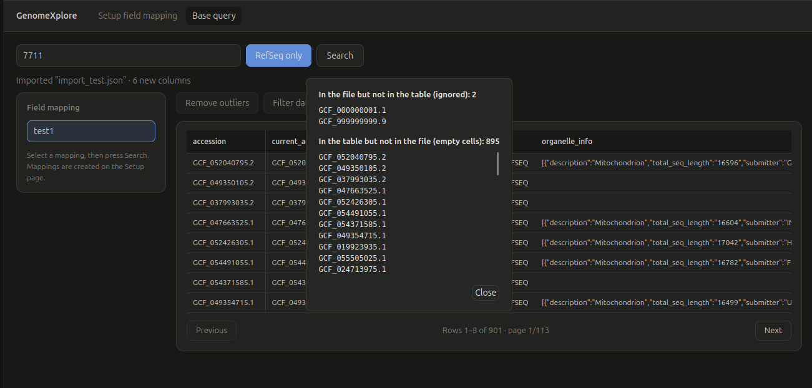

The new columns are then shown at the end of the table.

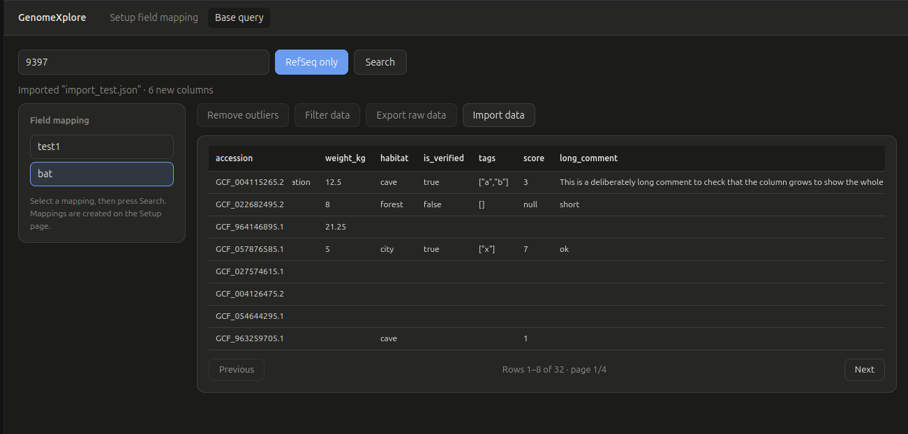

> **Not available yet:** the **Remove outliers**, **Filter data** and **Export raw data** buttons are disabled ("Coming soon").

---

## 3. Code infrastructure

GenomeXplore has two major components:

| Component    | Role                                                                           |
| ------------ | ------------------------------------------------------------------------------ |
| **Frontend** | Web page display and interactivity (plain HTML / CSS / JavaScript modules)     |
| **Backend**  | Database (NCBI API) queries and data transformation (Python, FastAPI)          |

The backend also serves the frontend files, so a single `uvicorn` command starts everything.

### How it all works together

The app has two pages. Both start from a taxid search, and both need the same raw NCBI data.

```text
Setup field mapping page                       Base query page
────────────────────────                       ───────────────
taxid + RefSeq toggle                          taxid + RefSeq toggle + chosen mapping
        │                                               │
GET /api/ncbi/structure                        GET /api/ncbi/query
        │                                               │
  raw_cache ──► helpers/ncbi.py (NCBI API)      raw_cache ──► helpers/ncbi.py (NCBI API)
        │                                               │
  structure.py: count each field                 mappings.py: load the saved mapping
        │                                        flatten.py: keep only the mapped fields
  schema tree: user selects fields                       │
        │                                        result table (+ import extra data)
POST /api/field-mappings
  (saved in storage/field_mappings.json) ──────────────► reused as the mapping above
```

1. **Setup page**: search a taxid. The backend downloads all NCBI assembly reports of that taxon and returns the *structure* of the reports (every field and how many reports have it). The user selects the fields they care about in the schema tree and saves the selection as a **field mapping**.
2. **Query page**: search a taxid with a saved mapping. The backend returns one table row per report, containing only the mapped fields.


## 4. Potential improvements

assemblies : GWH, ensembl, nbci non reference
request params : common name,  scientific name
raw data : GWH , ensembl
filtering :  add filtering
outlier :  add outlier detection and exclusion
table : ordering, hide show columns, select deselect rows
